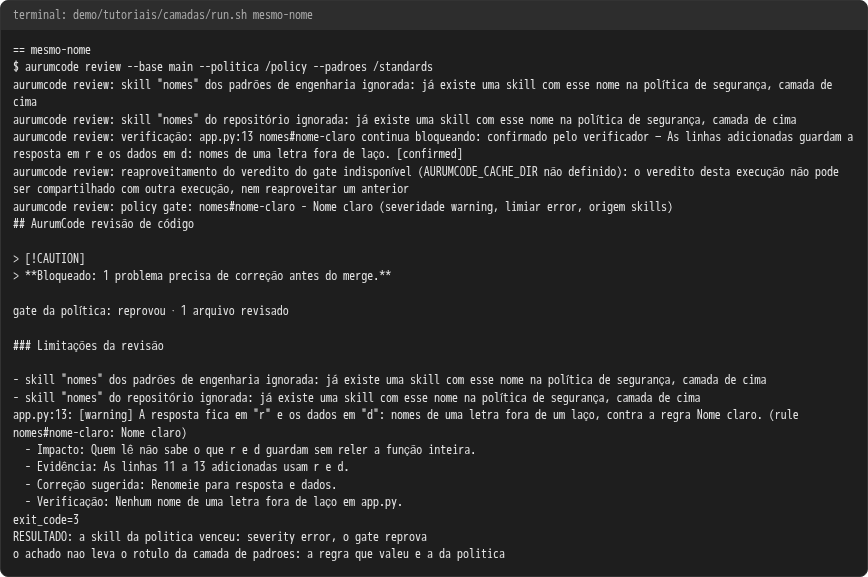
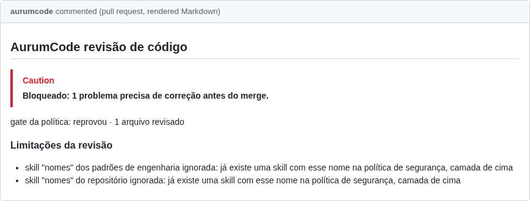
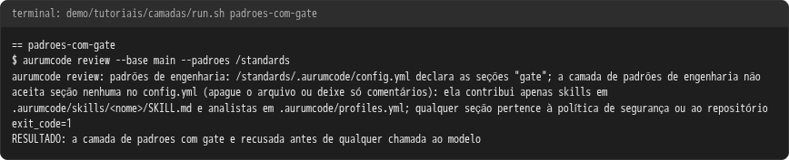
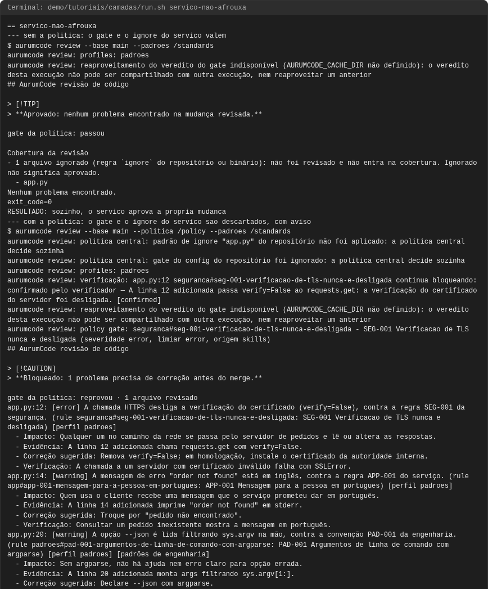
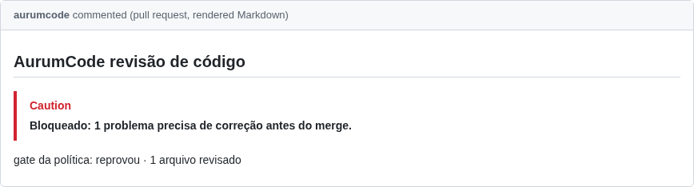
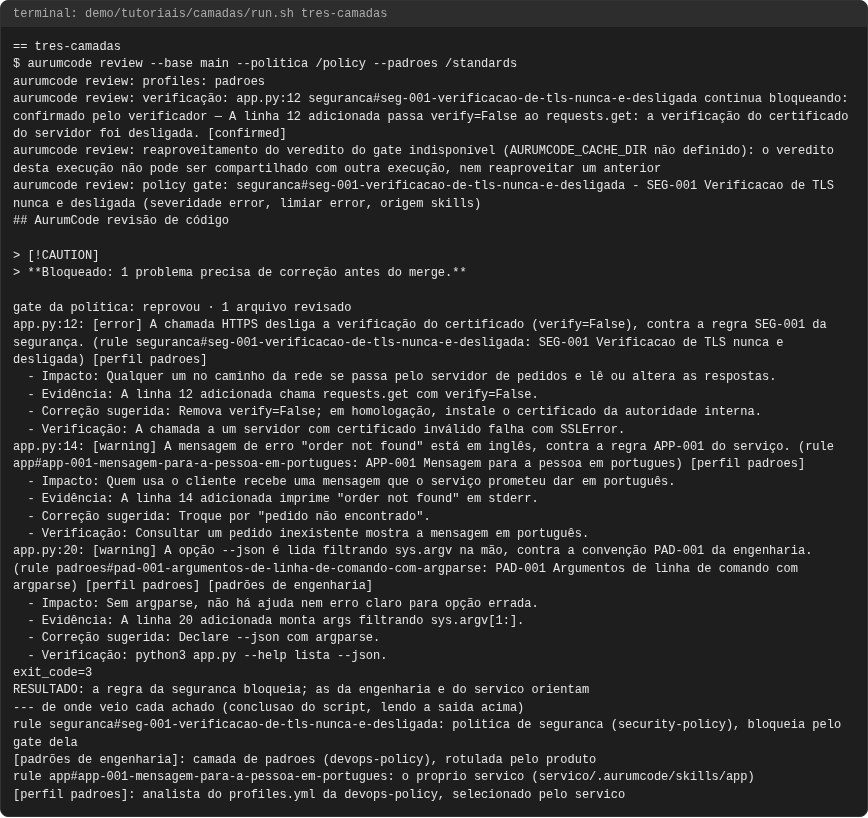

# Tutorial: camadas (política, padrões e serviço)

## Objetivo

Mostrar o AurumCode com **três repositórios**, um por time: a `security-policy`
(time de segurança: o gate e as regras que ninguém afrouxa), a `devops-policy`
(time de engenharia: as regras e os analistas comuns a todos os serviços) e o
`servico` (o repositório revisado, que só escolhe idioma e analistas). Quatro
casos, todos executados: os achados das três camadas no mesmo parecer, cada um
com a sua origem; o serviço tentando afrouxar o gate e tirar um arquivo da
revisão sem conseguir; uma skill com o mesmo nome nas três camadas e a ordem
que decide qual vale; e a recusa de uma camada de padrões que tenta declarar
um gate.

Os blocos de configuração **são os arquivos de `demo/tutoriais/camadas/`**,
byte a byte, e as saídas vêm de uma execução real registrada em
`demo/tutoriais/camadas/out/` (`run.sh --check` e
`tests/acceptance/AUR-614.sh` conferem).

## Pré-requisitos

- `git`, `docker`, `bash` e a imagem do produto, como em
  [revisao.md](revisao.md). Nenhuma credencial: o modelo é um JSON
  determinístico (`AURUMCODE_LLM_FIXTURE`) e os containers rodam sem rede.
  Para repetir um caso à mão, use o atalho de [revisao.md](revisao.md) com
  `TUTORIAL_DIR=/caminho/para/AurumCode/demo/tutoriais/camadas` (montado em
  `/fixtures`), acrescente ao atalho as duas pastas centrais
  (`-v "/caminho/da/security-policy:/policy:ro"` e
  `-v "/caminho/da/devops-policy:/standards:ro"`) e exporte
  `AURUMCODE_LLM_FIXTURE=/fixtures/fixture-llm.json`.
- Ler [politica-central.md](politica-central.md) (a camada de cima) e
  [skills.md](skills.md) (as seções das skills são as regras que o gate cobra).

```bash
bash demo/tutoriais/camadas/run.sh all      # executa os quatro casos e grava out/
bash demo/tutoriais/camadas/run.sh --check  # compara out/ com expected/, sem docker
```

## As três camadas

| Camada | Repositório e quem mantém | Como entra na revisão | O que pode declarar |
|---|---|---|---|
| política de segurança | `security-policy`, time de segurança | `--politica <dir>` (no workflow, `policy_repository`) | o `config.yml` com autoridade (`gate`, `ignore`, `exceptions`, `rules`, idioma…) e skills |
| padrões de engenharia | `devops-policy`, time de engenharia | `--padroes <dir>` (no workflow, `standards_repository`) | só skills (`.aurumcode/skills/<nome>/SKILL.md`) e analistas (`.aurumcode/profiles.yml`); nenhuma seção de `config.yml` |
| repositório | o próprio serviço | a branch base da PR | o que a política não tomou: idioma, `review.profiles`, skills e analistas próprios |

A ordem é **política de segurança > padrões de engenharia > repositório**. Os
dois diretórios centrais ficam **fora** da árvore revisada (o programa recusa
um que resolva para dentro dela); cada um é o diretório que *contém*
`.aurumcode/`. No workflow reutilizável, `policy_repository` e
`standards_repository` fazem esse checkout por você; a referência de
configuração tem a tabela completa em
[Camada de padrões de engenharia](../configuration.md#camada-de-padroes-de-engenharia).

## Caso 1: as três camadas no mesmo parecer

A `security-policy` declara o gate (reprova a partir de `error`, bloqueia o
que for inconclusivo), o idioma e a regra SEG-001:

<!-- arquivo: demo/tutoriais/camadas/security-policy/.aurumcode/config.yml -->
```yaml
# Repositorio security-policy: mantido pelo time de seguranca.
# E a politica central: o gate declarado aqui vale para todo servico, e um
# servico nao consegue afrouxa-lo nem tirar um arquivo da revisao.
gate:
  fail_on: [error]        # achado error (skill, modelo ou ferramenta) reprova o merge
  inconclusive: block     # revisao que nao concluiu nunca aprova
review:
  language: pt-BR         # o idioma do parecer e decisao da politica
```

<!-- arquivo: demo/tutoriais/camadas/security-policy/.aurumcode/skills/seguranca/SKILL.md -->
```markdown
---
name: seguranca
version: 1
languages: [python]
---
Regras do time de seguranca, iguais para todos os servicos. Cada `## ` abaixo
e uma regra citavel pelo AurumCode; `severity: error` reprova o merge.

## SEG-001 Verificacao de TLS nunca e desligada
severity: error
Toda chamada HTTPS valida o certificado do servidor: `verify=False`,
`ssl.CERT_NONE` ou `check_hostname = False` nunca entram no codigo, nem
"so em homologacao".
```

A `devops-policy` não declara seção nenhuma no `config.yml` (o arquivo só tem
comentário); ela traz a regra PAD-001 e o analista `padroes`:

<!-- arquivo: demo/tutoriais/camadas/devops-policy/.aurumcode/config.yml -->
```yaml
# Repositorio devops-policy: mantido pelo time de engenharia.
# A camada de padroes nao declara secao nenhuma: gate, ignore, excecoes,
# regras, scanners e publicacao ficam com a security-policy e com o servico.
# Aqui so skills/ (regras) e profiles.yml (analistas).
```

<!-- arquivo: demo/tutoriais/camadas/devops-policy/.aurumcode/skills/padroes/SKILL.md -->
```markdown
---
name: padroes
version: 1
paths: ["**/*.py"]
---
Convencoes do time de engenharia, iguais para todos os servicos. Cada `## `
abaixo e uma regra citavel; `severity: warning` orienta sem bloquear o merge.

## PAD-001 Argumentos de linha de comando com argparse
severity: warning
Opcao de linha de comando e lida com `argparse` (ajuda, validacao e erro
claros), nunca filtrando `sys.argv` na mao.
```

<!-- arquivo: demo/tutoriais/camadas/devops-policy/.aurumcode/profiles.yml -->
```yaml
# Analistas do time de engenharia, disponiveis para todo servico que os
# selecionar em review.profiles. Cada um e uma passada do modelo com o seu
# foco; o achado sai no parecer marcado com o analista.
profiles:
  - name: padroes
    version: "1"
    emphasis: "padroes de codigo da engenharia"
    families: ["quality"]
    instructions: "Analista de padroes da engenharia: confira no codigo alterado as convencoes das skills de todas as camadas e cite a regra da skill em cada achado."
```

O `servico` só escolhe o idioma e o analista (que vem da `devops-policy`), e
tem uma regra própria, APP-001:

<!-- arquivo: demo/tutoriais/camadas/servico/.aurumcode/config.yml -->
```yaml
# Servico: o minimo. O gate vem da security-policy; as regras e os analistas
# comuns vem da devops-policy. Aqui so o idioma e os analistas que rodam.
review:
  language: pt-BR
  profiles: [padroes]     # analista declarado no profiles.yml da devops-policy
```

<!-- arquivo: demo/tutoriais/camadas/servico/.aurumcode/skills/app/SKILL.md -->
```markdown
---
name: app
version: 1
paths: ["app.py"]
---
Convencoes deste servico, decididas pelo proprio time. Cada `## ` abaixo e
uma regra citavel; `severity: warning` orienta sem bloquear o merge.

## APP-001 Mensagem para a pessoa em portugues
severity: warning
Toda mensagem mostrada a quem usa o cliente (saida normal ou erro) e escrita
em portugues.
```

A mudança revisada (`servico-mudanca/app.py`, na branch `feature`) viola as
três regras de uma vez: desliga a verificação de TLS (`verify=False`, linha
12), imprime um erro em inglês (linha 14) e lê a opção `--json` filtrando
`sys.argv` na mão (linha 20). Os dois diretórios centrais são montados fora
do repositório (`/policy` e `/standards`):

```bash
aurumcode review --base main --politica /policy --padroes /standards
```

<!-- saida: tres-camadas -->
```text
aurumcode review: profiles: padroes
aurumcode review: policy gate: seguranca#seg-001-verificacao-de-tls-nunca-e-desligada - SEG-001 Verificacao de TLS nunca e desligada (severidade error, limiar error, origem skills)
> **Bloqueado: 1 problema precisa de correção antes do merge.**
app.py:12: [error] A chamada HTTPS desliga a verificação do certificado (verify=False), contra a regra SEG-001 da segurança. (rule seguranca#seg-001-verificacao-de-tls-nunca-e-desligada: SEG-001 Verificacao de TLS nunca e desligada) [perfil padroes]
app.py:14: [warning] A mensagem de erro "order not found" está em inglês, contra a regra APP-001 do serviço. (rule app#app-001-mensagem-para-a-pessoa-em-portugues: APP-001 Mensagem para a pessoa em portugues) [perfil padroes]
app.py:20: [warning] A opção --json é lida filtrando sys.argv na mão, contra a convenção PAD-001 da engenharia. (rule padroes#pad-001-argumentos-de-linha-de-comando-com-argparse: PAD-001 Argumentos de linha de comando com argparse) [perfil padroes] [padrões de engenharia]
exit_code=3
RESULTADO: a regra da seguranca bloqueia; as da engenharia e do servico orientam
rule seguranca#seg-001-verificacao-de-tls-nunca-e-desligada: politica de seguranca (security-policy), bloqueia pelo gate dela
[padrões de engenharia]: camada de padroes (devops-policy), rotulada pelo produto
rule app#app-001-mensagem-para-a-pessoa-em-portugues: o proprio servico (servico/.aurumcode/skills/app)
[perfil padroes]: analista do profiles.yml da devops-policy, selecionado pelo servico
```

O que observar: os três achados saem no mesmo parecer, cada um citando a
regra do seu repositório (`seguranca#…`, `padroes#…`, `app#…`), e todos
marcados com o analista que os encontrou (`[perfil padroes]`, declarado no
`profiles.yml` da `devops-policy` e selecionado pelo `servico`). O achado da
camada de padrões leva o rótulo `[padrões de engenharia]`, que o produto
acrescenta a toda regra vencida por essa camada; os outros dois não levam
rótulo de camada: o da política se reconhece pela regra citada e pela linha
do gate (`origem skills`), o do serviço pela regra `app#…`. Só o achado da
segurança reprova (`error`, o limiar do gate da política): saída 3. As quatro
últimas linhas são conclusão do script (não é saída do produto): cada uma é
impressa quando o trecho correspondente está na saída acima. (`RESULTADO:`
também é conclusão do script: vale quando o `exit_code` é o esperado.)

Uma regra do jogo que não aparece acima, mas decide o que o modelo recebe: uma
skill da política com o **mesmo seletor** (`languages` ou `paths` iguais) de
uma skill de baixo faz a de baixo não ser enviada, com aviso no parecer. Por
isso as três skills deste tutorial declaram seletores diferentes
(`languages: [python]`, `paths: ["**/*.py"]`, `paths: ["app.py"]`); veja o
caso 4 de [skills.md](skills.md).

## Caso 2: o serviço tenta afrouxar e a política vence

O `servico-afrouxa` é o mesmo serviço, mas o `config.yml` dele declara um
gate próprio, mais frouxo (`inconclusive: warn`: uma revisão que não concluiu
passaria), e tira da revisão justamente o arquivo alterado:

<!-- arquivo: demo/tutoriais/camadas/servico-afrouxa/.aurumcode/config.yml -->
```yaml
# Servico que tenta decidir a seguranca por conta propria.
review:
  language: pt-BR
  profiles: [padroes]
gate:
  fail_on: [high]
  inconclusive: warn      # uma revisao que nao concluiu passaria
ignore:
  - "app.py"              # tira da revisao justamente o arquivo alterado
```

A mesma mudança do caso 1, primeiro só com a camada de padrões (sem a
política), depois com as duas:

```bash
aurumcode review --base main --padroes /standards
aurumcode review --base main --politica /policy --padroes /standards
```

<!-- saida: servico-nao-afrouxa -->
```text
$ aurumcode review --base main --padroes /standards
> **Aprovado: nenhum problema encontrado na mudança revisada.**
- 1 arquivo ignorado (regra `ignore` do repositório ou binário): não foi revisado e não entra na cobertura. Ignorado não significa aprovado.
exit_code=0
RESULTADO: sozinho, o servico aprova a propria mudanca
$ aurumcode review --base main --politica /policy --padroes /standards
aurumcode review: politica central: padrão de ignore "app.py" do repositório não foi aplicado: a política central decide sozinha
aurumcode review: politica central: gate do config do repositório foi ignorado: a política central decide sozinha
> **Bloqueado: 1 problema precisa de correção antes do merge.**
aurumcode review: policy gate: seguranca#seg-001-verificacao-de-tls-nunca-e-desligada - SEG-001 Verificacao de TLS nunca e desligada (severidade error, limiar error, origem skills)
exit_code=3
RESULTADO: o servico nao consegue afrouxar a politica
```

O que observar: sozinho, o serviço se aprova (saída 0): o `ignore` dele tirou
`app.py` da revisão e a regra SEG-001 nem existe para ele (ela mora na
política). Com a política, o `ignore` e o `gate` do serviço são descartados,
cada um com um aviso que diz o que foi descartado e por quê (`a política
central decide sozinha`), a skill da segurança entra e a mesma mudança é
bloqueada: saída 3. Para destravar, quem muda é a política, por um PR no
repositório dela. A camada de padrões não participa dessa disputa: ela nunca
declara `gate` nem `ignore` (veja o caso de falha).

## Caso 3: a mesma skill nas três camadas

As três camadas declaram uma skill com o mesmo nome de diretório, `nomes`, e
a mesma seção `## Nome claro` (logo, o mesmo id de regra `nomes#nome-claro`),
com severidade diferente: `error` na política, `warning` nas outras duas:

<!-- arquivo: demo/tutoriais/camadas/security-policy-mesmo-nome/.aurumcode/skills/nomes/SKILL.md -->
```markdown
---
name: nomes
version: 1
languages: [python]
---
Versao da politica de seguranca da skill "nomes": e esta que vale.

## Nome claro
severity: error
Variavel, funcao e parametro tem nome que diz o que guardam; nome de uma
letra so em indice de laco. Para a seguranca, nome enganoso esconde
credencial e dado pessoal: reprova.
```

<!-- arquivo: demo/tutoriais/camadas/devops-policy-mesmo-nome/.aurumcode/skills/nomes/SKILL.md -->
```markdown
---
name: nomes
version: 1
paths: ["**/*.py"]
---
Versao da engenharia da skill "nomes": ignorada quando a politica declara
uma skill com o mesmo nome.

## Nome claro
severity: warning
Variavel, funcao e parametro tem nome que diz o que guardam; nome de uma
letra so em indice de laco. Para a engenharia, e legibilidade: orienta.
```

<!-- arquivo: demo/tutoriais/camadas/servico-mesmo-nome/.aurumcode/skills/nomes/SKILL.md -->
```markdown
---
name: nomes
version: 1
paths: ["app.py"]
---
Versao do proprio servico da skill "nomes": ignorada quando uma camada de
cima declara uma skill com o mesmo nome.

## Nome claro
severity: warning
Nome curto e aceito quando o escopo e de poucas linhas.
```

A mudança (`servico-mesmo-nome-mudanca/app.py`) guarda a resposta em `r` e os
dados em `d`; o modelo cita `nomes#nome-claro` como `warning`:

```bash
aurumcode review --base main --politica /policy --padroes /standards
```

<!-- saida: mesmo-nome -->
```text
aurumcode review: skill "nomes" dos padrões de engenharia ignorada: já existe uma skill com esse nome na política de segurança, camada de cima
aurumcode review: skill "nomes" do repositório ignorada: já existe uma skill com esse nome na política de segurança, camada de cima
aurumcode review: policy gate: nomes#nome-claro - Nome claro (severidade warning, limiar error, origem skills)
app.py:13: [warning] A resposta fica em "r" e os dados em "d": nomes de uma letra fora de um laço, contra a regra Nome claro. (rule nomes#nome-claro: Nome claro)
exit_code=3
RESULTADO: a skill da politica venceu: severity error, o gate reprova
o achado nao leva o rotulo da camada de padroes: a regra que valeu e a da politica
```

O que observar: os dois avisos nomeiam a camada que perdeu e a que venceu: a
skill `nomes` da camada de padrões e a do repositório foram ignoradas porque
a política declara uma com o mesmo nome. O que prova qual versão valeu é o
gate: o modelo deu `warning` ao achado, mas o limiar compara a maior entre a
severidade do modelo e a que a própria seção da skill declara, e a seção que
valeu é a da política, `severity: error`: saída 3. Se a versão da engenharia
ou a do serviço tivesse vencido, a seção valeria `warning`, abaixo do limiar,
e o gate passaria. O achado não leva o rótulo `[padrões de engenharia]`,
porque a regra que valeu não é da camada de padrões (a última linha é
conclusão do script, impressa quando o rótulo não aparece). Sem a política
declarar `nomes`, a ordem continua valendo um degrau abaixo: a versão da
engenharia vence a do serviço, e o aviso nomeia essas duas camadas (é o que a
referência de configuração descreve e os testes do produto cobrem; aqui foi
demonstrado o caso com as três).

## Quando falha: a camada de padrões declara um gate

A camada de padrões só pode trazer skills e analistas. Esta tenta declarar um
`gate`:

<!-- arquivo: demo/tutoriais/camadas/devops-policy-com-gate/.aurumcode/config.yml -->
```yaml
# Tentativa errada: a camada de padroes declarando um gate.
# A camada so pode trazer skills e analistas; este arquivo e recusado.
gate:
  fail_on: [error]
```

```bash
aurumcode review --base main --padroes /standards
```

<!-- saida: padroes-com-gate -->
```text
aurumcode review: padrões de engenharia: /standards/.aurumcode/config.yml declara as seções "gate"; a camada de padrões de engenharia não aceita seção nenhuma no config.yml (apague o arquivo ou deixe só comentários): ela contribui apenas skills em .aurumcode/skills/<nome>/SKILL.md e analistas em .aurumcode/profiles.yml; qualquer seção pertence à política de segurança ou ao repositório
exit_code=1
RESULTADO: a camada de padroes com gate e recusada antes de qualquer chamada ao modelo
```

O que observar: é erro de carga, saída 1, antes de qualquer chamada ao modelo,
e a mensagem nomeia o arquivo, a seção encontrada, o que a camada pode trazer
e o que fazer (apagar o arquivo ou deixar só comentários). O mesmo
vale para `ignore`, `exceptions`, `rules`, `quality_gates`, `publication` ou
qualquer outra seção: a camada de padrões nunca decide o que bloqueia. Uma
camada quebrada **bloqueia** em vez de liberar em silêncio, como a política
inválida de [politica-central.md](politica-central.md).

## Problemas comuns

- **O achado da engenharia sumiu**: confira que `--padroes` (ou
  `standards_repository` no workflow) aponta para o diretório que *contém*
  `.aurumcode/`. Sem a camada, uma regra `padroes#…` citada pelo modelo é
  descartada como regra desconhecida.
- **"skill … ignorada: já existe uma skill com esse nome na … camada de
  cima"**: não é erro. Duas camadas declararam o mesmo nome de diretório de
  skill; valeu a de cima. Renomeie a de baixo ou apague-a.
- **"a skill da política … prevalece sobre a skill do repositório …: mesmo
  seletor"** (em inglês, "policy skill … overrides repository skill …"): uma skill
  da política tem o mesmo seletor (`languages`/`paths`) de uma skill de baixo,
  e a de baixo não foi enviada ao modelo. Dê seletores diferentes às skills de
  cada camada.
- **"a política central decide sozinha"** num aviso: o serviço declarou algo
  que a política governa (`gate`, `ignore`, `exceptions`, `rules`); o do
  serviço foi descartado. Para mudar, mude a política.
- **A camada de padrões é recusada**: o `config.yml` dela tem alguma seção.
  Deixe-o vazio ou só com comentários; `gate` e `ignore` vão para a política.
- **Analista desconhecido em `review.profiles`**: o analista precisa existir
  no `profiles.yml` da camada de padrões ou do próprio repositório; um nome
  igual nas duas camadas vale o da camada de padrões, com aviso.

<!-- capturas:inicio (gerado por scripts/docs/capturas.sh; nao editar a mao) -->
## Como fica

Capturas geradas por scripts/docs/capturas.sh a partir das saídas gravadas em demo/tutoriais/camadas/out/: o terminal de cada caso e, quando o caso publica, o comentario do PR e os status checks. O manifesto docs/assets/capturas/capturas.json registra o digest de cada insumo.

### mesmo-nome





### padroes-com-gate



### servico-nao-afrouxa





### tres-camadas




<!-- capturas:fim -->
