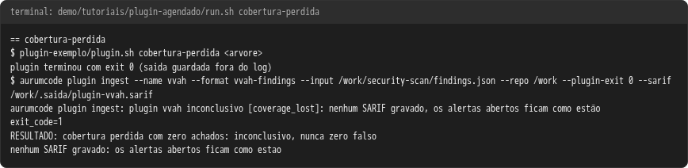
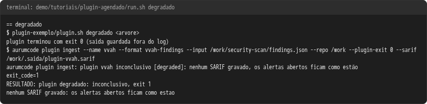
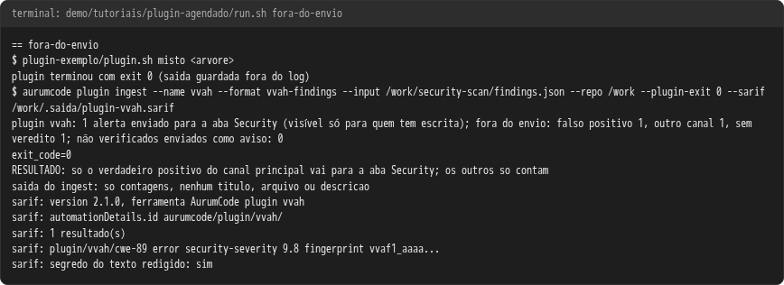
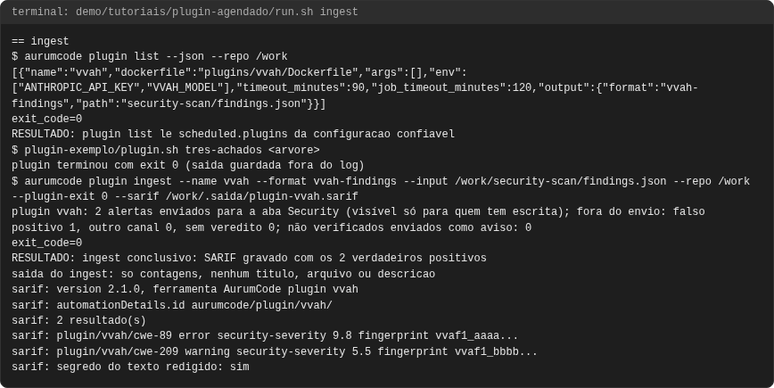
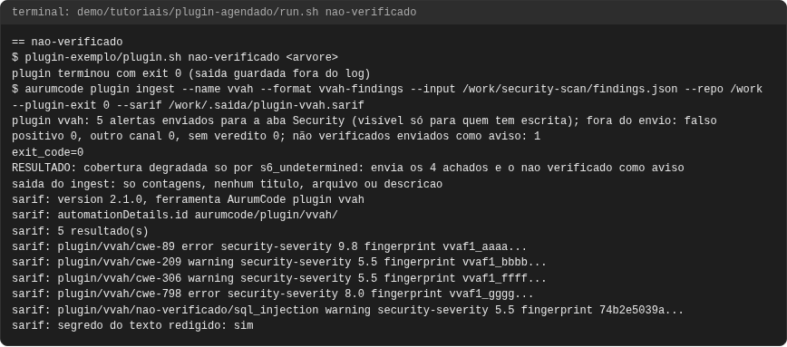
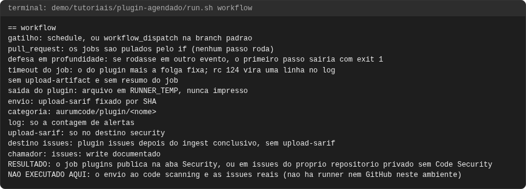
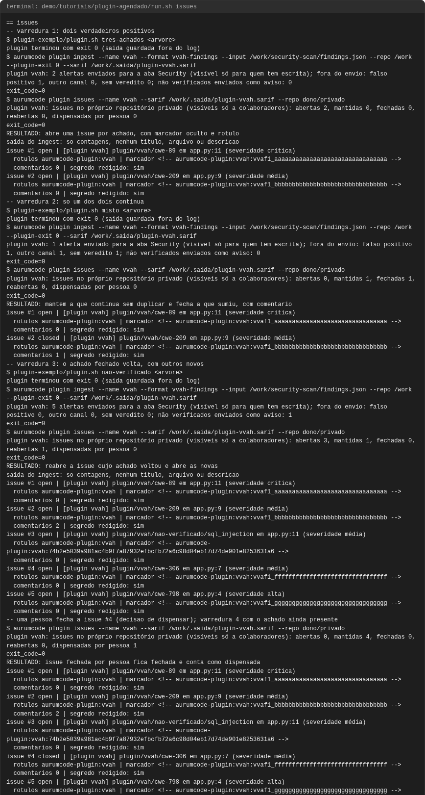
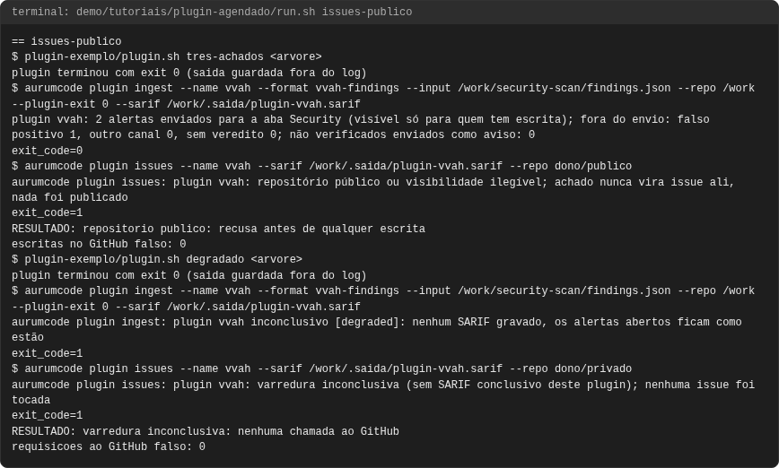

# Tutorial: plugin externo na validação agendada (`scheduled.plugins`)

## Objetivo

Um scanner externo (por exemplo, um harness agêntico de vulnerabilidade) roda
na validação **agendada**, no próprio container, e os achados dele vão para a
aba Security (code scanning), que exige permissão de escrita, ou, num
repositório privado sem Code Security, para issues do próprio repositório. Nada do
achado aparece no log do Actions, no resumo do job, em artefato ou na PR, que
num repositório público são públicos. Ao final você terá visto, com o binário
real do produto:

1. o `ingest` de um plugin: SARIF só com os verdadeiros positivos e a saída
   do comando só com contagens;
2. falso positivo, canal `posture` e achado sem veredito **fora do envio**,
   contados;
3. **dúvida nunca some**: candidato que o plugin não conseguiu verificar vira
   alerta de aviso "não verificado";
4. o job `plugins` do workflow reutilizável (conferência estática);
5. **repositório privado sem Code Security**: os achados viram issues do
   próprio repositório, uma por achado, abertas, mantidas, fechadas e
   reabertas a cada varredura (contra um GitHub falso local);
6. quando falha: plugin **degradado** e **cobertura perdida com zero
   achados** — inconclusivo, exit 1 e nenhum SARIF (um SARIF vazio fecharia
   os alertas abertos); e **repositório público**, onde achado nunca vira
   issue.

O contrato completo está em [plugins agendados](../plugins-agendados.md).
Cada saída abaixo vem de uma execução real, registrada em
`demo/tutoriais/plugin-agendado/out/` e conferida por `run.sh --check`. Os
blocos marcados com o caminho **são os arquivos da demonstração**, byte a
byte.

### Como a demonstração prova isso sem modelo e sem rede

O plugin de exemplo (`plugin-exemplo/plugin.sh`) faz o papel do harness: não
chama modelo nenhum, só copia para `security-scan/` da árvore um
`findings.json` e o SARIF do harness sintéticos do cenário pedido. O
`aurumcode plugin list` e o `aurumcode plugin ingest` rodam na imagem do
produto, sem rede. O `aurumcode plugin issues` também roda na imagem do
produto, mas fala só com um GitHub falso em `127.0.0.1`
(`github-falso-issues.py`, que guarda as issues em memória e anota cada
requisição), nunca com o GitHub.

<!-- arquivo: demo/tutoriais/plugin-agendado/plugin-exemplo/plugin.sh -->
```bash
#!/usr/bin/env bash
# Plugin de exemplo OFFLINE: faz o papel do harness sem modelo e sem rede.
# Copia para <arvore>/security-scan/ o findings.json e o SARIF do harness do
# cenario pedido e sai com exit 0, como o harness quando conclui (inclusive
# quando perdeu cobertura: o ingest le degraded e o SARIF do harness).
#
#   plugin.sh <cenario> <arvore>
#   cenarios: tres-achados | misto | nao-verificado | degradado | cobertura-perdida
set -euo pipefail
cenario="$1"; arvore="$2"
aqui="$(cd "$(dirname "${BASH_SOURCE[0]}")" && pwd -P)"
saida="$arvore/security-scan"
rm -rf "$saida"; mkdir -p "$saida"
cp "$aqui/fixtures/$cenario/findings.json" "$saida/findings.json"
cp "$aqui/fixtures/$cenario/report.sarif" "$saida/alvo_20261014T000000_report.sarif"
exit 0
```

## Pré-requisitos

- `git`, `docker`, `bash` e `python3` no host. Nada mais.
- A imagem do produto, construída do `Dockerfile` da raiz (o `run.sh` faz
  isso sozinho).

### Rodar a demonstração

```bash
bash demo/tutoriais/plugin-agendado/run.sh all
bash demo/tutoriais/plugin-agendado/run.sh --check
```

A configuração do repositório de exemplo declara um plugin:

<!-- arquivo: demo/tutoriais/plugin-agendado/repo-exemplo/.aurumcode/config.yml -->
```yaml
scheduled:
  plugins:
    - name: vvah
      dockerfile: plugins/vvah/Dockerfile
      env: [ANTHROPIC_API_KEY, VVAH_MODEL]
      output:
        format: vvah-findings
        path: security-scan/findings.json
      timeout_minutes: 90
```

## Caso 1: ingest

O plugin acha três casos: dois verdadeiros positivos e um falso positivo. O
ingest grava o SARIF com os dois primeiros (regra `plugin/vvah/<cwe>`,
fingerprint `case_id` do harness, categoria `aurumcode/plugin/vvah`) e o
texto do achado passa pelo filtro de segredos. O que o comando imprime é só a
contagem.

```bash
bash demo/tutoriais/plugin-agendado/run.sh ingest
```

```text
== ingest
$ aurumcode plugin list --json --repo /work
[{"name":"vvah","dockerfile":"plugins/vvah/Dockerfile","args":[],"env":["ANTHROPIC_API_KEY","VVAH_MODEL"],"timeout_minutes":90,"job_timeout_minutes":120,"output":{"format":"vvah-findings","path":"security-scan/findings.json"}}]
exit_code=0
RESULTADO: plugin list le scheduled.plugins da configuracao confiavel
$ plugin-exemplo/plugin.sh tres-achados <arvore>
plugin terminou com exit 0 (saida guardada fora do log)
$ aurumcode plugin ingest --name vvah --format vvah-findings --input /work/security-scan/findings.json --repo /work --plugin-exit 0 --sarif /work/.saida/plugin-vvah.sarif
plugin vvah: 2 alertas enviados para a aba Security (visível só para quem tem escrita); fora do envio: falso positivo 1, outro canal 0, sem veredito 0; não verificados enviados como aviso: 0
exit_code=0
RESULTADO: ingest conclusivo: SARIF gravado com os 2 verdadeiros positivos
saida do ingest: so contagens, nenhum titulo, arquivo ou descricao
sarif: version 2.1.0, ferramenta AurumCode plugin vvah
sarif: automationDetails.id aurumcode/plugin/vvah/
sarif: 2 resultado(s)
sarif: plugin/vvah/cwe-89 error security-severity 9.8 fingerprint vvaf1_aaaa...
sarif: plugin/vvah/cwe-209 warning security-severity 5.5 fingerprint vvaf1_bbbb...
sarif: segredo do texto redigido: sim
```

## Caso 2: fora do envio

Só achado do canal principal com veredito `TRUE_POSITIVE` vira alerta. O
falso positivo, o canal `posture` e o achado sem veredito só contam.

```bash
bash demo/tutoriais/plugin-agendado/run.sh fora-do-envio
```

```text
== fora-do-envio
$ plugin-exemplo/plugin.sh misto <arvore>
plugin terminou com exit 0 (saida guardada fora do log)
$ aurumcode plugin ingest --name vvah --format vvah-findings --input /work/security-scan/findings.json --repo /work --plugin-exit 0 --sarif /work/.saida/plugin-vvah.sarif
plugin vvah: 1 alerta enviado para a aba Security (visível só para quem tem escrita); fora do envio: falso positivo 1, outro canal 1, sem veredito 1; não verificados enviados como aviso: 0
exit_code=0
RESULTADO: so o verdadeiro positivo do canal principal vai para a aba Security; os outros so contam
saida do ingest: so contagens, nenhum titulo, arquivo ou descricao
sarif: version 2.1.0, ferramenta AurumCode plugin vvah
sarif: automationDetails.id aurumcode/plugin/vvah/
sarif: 1 resultado(s)
sarif: plugin/vvah/cwe-89 error security-severity 9.8 fingerprint vvaf1_aaaa...
sarif: segredo do texto redigido: sim
```

## Caso 3: dúvida nunca some

Na execução real com a montagem do job, o harness achou 4 verdadeiros
positivos, descartou um candidato como `INCONCLUSIVE` (a verificação não
decidiu) e o SARIF dele disse `coverageDegraded: true` só por
`s6_undetermined`. Esse motivo é conhecido e está representado nos alertas:
o candidato inconclusivo vira um alerta de **aviso**
`plugin/<nome>/nao-verificado/<classe>`, e o envio segue. Descartes por
`DUPLICATE` ou `FALSE_POSITIVE` não viram alerta.

```bash
bash demo/tutoriais/plugin-agendado/run.sh nao-verificado
```

```text
== nao-verificado
$ plugin-exemplo/plugin.sh nao-verificado <arvore>
plugin terminou com exit 0 (saida guardada fora do log)
$ aurumcode plugin ingest --name vvah --format vvah-findings --input /work/security-scan/findings.json --repo /work --plugin-exit 0 --sarif /work/.saida/plugin-vvah.sarif
plugin vvah: 5 alertas enviados para a aba Security (visível só para quem tem escrita); fora do envio: falso positivo 0, outro canal 0, sem veredito 0; não verificados enviados como aviso: 1
exit_code=0
RESULTADO: cobertura degradada so por s6_undetermined: envia os 4 achados e o nao verificado como aviso
saida do ingest: so contagens, nenhum titulo, arquivo ou descricao
sarif: version 2.1.0, ferramenta AurumCode plugin vvah
sarif: automationDetails.id aurumcode/plugin/vvah/
sarif: 5 resultado(s)
sarif: plugin/vvah/cwe-89 error security-severity 9.8 fingerprint vvaf1_aaaa...
sarif: plugin/vvah/cwe-209 warning security-severity 5.5 fingerprint vvaf1_bbbb...
sarif: plugin/vvah/cwe-306 warning security-severity 5.5 fingerprint vvaf1_ffff...
sarif: plugin/vvah/cwe-798 error security-severity 8.0 fingerprint vvaf1_gggg...
sarif: plugin/vvah/nao-verificado/sql_injection warning security-severity 5.5 fingerprint 74b2e5039a...
sarif: segredo do texto redigido: sim
```

## Caso 4: o job agendado

O job `plugins` do `.github/workflows/review.yml` roda em `schedule` e em
`workflow_dispatch` na branch padrão. Num `pull_request` os jobs são
**pulados** pelo `if:` (nenhum passo roda); o primeiro passo, que sai com
exit 1 em qualquer outro evento, é defesa em profundidade.
A saída do plugin vai para um arquivo em `$RUNNER_TEMP` que nunca é impresso
nem vira artefato. O passo "Choose destination" decide o destino pela
visibilidade: no destino `security` o SARIF segue direto para o code
scanning; no destino `issues` o passo "Sync issues" roda
`aurumcode plugin issues` (sem upload-sarif), só depois de um ingest
conclusivo.

```bash
bash demo/tutoriais/plugin-agendado/run.sh workflow
```

```text
== workflow
gatilho: schedule, ou workflow_dispatch na branch padrao
pull_request: os jobs sao pulados pelo if (nenhum passo roda)
defesa em profundidade: se rodasse em outro evento, o primeiro passo sairia com exit 1
timeout do job: o do plugin mais a folga fixa; rc 124 vira uma linha no log
sem upload-artifact e sem resumo do job
saida do plugin: arquivo em RUNNER_TEMP, nunca impresso
envio: upload-sarif fixado por SHA
categoria: aurumcode/plugin/<nome>
log: so a contagem de alertas
upload-sarif: so no destino security
destino issues: plugin issues depois do ingest conclusivo, sem upload-sarif
chamador: issues: write documentado
RESULTADO: o job plugins publica na aba Security, ou em issues do proprio repositorio privado sem Code Security
NAO EXECUTADO AQUI: o envio ao code scanning e as issues reais (nao ha runner nem GitHub neste ambiente)
```

## Caso 5: issues no repositório privado sem Code Security

Num repositório privado sem GitHub Code Security não há aba Security para
alertas de código: os achados viram **issues do próprio repositório**, que
só os colaboradores veem. Cada issue leva na primeira linha do corpo um
marcador oculto com o fingerprint estável do achado
(`<!-- aurumcode-plugin:<nome>:<fingerprint> -->`) e o rótulo
`aurumcode-plugin:<nome>`. O título só tem campos estruturados (regra,
arquivo, linha, severidade); a descrição redigida fica no corpo, num bloco
de código. Três varreduras seguidas contra o GitHub falso:

1. dois verdadeiros positivos: abre 2 issues;
2. só um deles continua: mantém a que continua sem duplicar e fecha a que
   sumiu, com um comentário;
3. o achado fechado volta, com outros novos: reabre a issue dele e abre as
   novas;
4. uma pessoa fecha uma issue cujo achado continua: a decisão humana vale,
   a issue fica fechada, sem escrita nela, e conta como "dispensada por
   pessoa". Só é reaberta a issue que o **próprio plugin** fechou (o
   comentário de fechamento dele leva o marcador oculto
   `<!-- aurumcode-plugin:<nome>:fechado -->` e é o último da issue).

```bash
bash demo/tutoriais/plugin-agendado/run.sh issues
```

```text
== issues
-- varredura 1: dois verdadeiros positivos
$ plugin-exemplo/plugin.sh tres-achados <arvore>
plugin terminou com exit 0 (saida guardada fora do log)
$ aurumcode plugin ingest --name vvah --format vvah-findings --input /work/security-scan/findings.json --repo /work --plugin-exit 0 --sarif /work/.saida/plugin-vvah.sarif
plugin vvah: 2 alertas enviados para a aba Security (visível só para quem tem escrita); fora do envio: falso positivo 1, outro canal 0, sem veredito 0; não verificados enviados como aviso: 0
exit_code=0
$ aurumcode plugin issues --name vvah --sarif /work/.saida/plugin-vvah.sarif --repo dono/privado
plugin vvah: issues no próprio repositório privado (visíveis só a colaboradores): abertas 2, mantidas 0, fechadas 0, reabertas 0, dispensadas por pessoa 0
exit_code=0
RESULTADO: abre uma issue por achado, com marcador oculto e rotulo
saida do ingest: so contagens, nenhum titulo, arquivo ou descricao
issue #1 open | [plugin vvah] plugin/vvah/cwe-89 em app.py:11 (severidade crítica)
  rotulos aurumcode-plugin:vvah | marcador <!-- aurumcode-plugin:vvah:vvaf1_aaaaaaaaaaaaaaaaaaaaaaaaaaaaaaaa -->
  comentarios 0 | segredo redigido: sim
issue #2 open | [plugin vvah] plugin/vvah/cwe-209 em app.py:9 (severidade média)
  rotulos aurumcode-plugin:vvah | marcador <!-- aurumcode-plugin:vvah:vvaf1_bbbbbbbbbbbbbbbbbbbbbbbbbbbbbbbb -->
  comentarios 0 | segredo redigido: sim
-- varredura 2: so um dos dois continua
$ plugin-exemplo/plugin.sh misto <arvore>
plugin terminou com exit 0 (saida guardada fora do log)
$ aurumcode plugin ingest --name vvah --format vvah-findings --input /work/security-scan/findings.json --repo /work --plugin-exit 0 --sarif /work/.saida/plugin-vvah.sarif
plugin vvah: 1 alerta enviado para a aba Security (visível só para quem tem escrita); fora do envio: falso positivo 1, outro canal 1, sem veredito 1; não verificados enviados como aviso: 0
exit_code=0
$ aurumcode plugin issues --name vvah --sarif /work/.saida/plugin-vvah.sarif --repo dono/privado
plugin vvah: issues no próprio repositório privado (visíveis só a colaboradores): abertas 0, mantidas 1, fechadas 1, reabertas 0, dispensadas por pessoa 0
exit_code=0
RESULTADO: mantem a que continua sem duplicar e fecha a que sumiu, com comentario
issue #1 open | [plugin vvah] plugin/vvah/cwe-89 em app.py:11 (severidade crítica)
  rotulos aurumcode-plugin:vvah | marcador <!-- aurumcode-plugin:vvah:vvaf1_aaaaaaaaaaaaaaaaaaaaaaaaaaaaaaaa -->
  comentarios 0 | segredo redigido: sim
issue #2 closed | [plugin vvah] plugin/vvah/cwe-209 em app.py:9 (severidade média)
  rotulos aurumcode-plugin:vvah | marcador <!-- aurumcode-plugin:vvah:vvaf1_bbbbbbbbbbbbbbbbbbbbbbbbbbbbbbbb -->
  comentarios 1 | segredo redigido: sim
-- varredura 3: o achado fechado volta, com outros novos
$ plugin-exemplo/plugin.sh nao-verificado <arvore>
plugin terminou com exit 0 (saida guardada fora do log)
$ aurumcode plugin ingest --name vvah --format vvah-findings --input /work/security-scan/findings.json --repo /work --plugin-exit 0 --sarif /work/.saida/plugin-vvah.sarif
plugin vvah: 5 alertas enviados para a aba Security (visível só para quem tem escrita); fora do envio: falso positivo 0, outro canal 0, sem veredito 0; não verificados enviados como aviso: 1
exit_code=0
$ aurumcode plugin issues --name vvah --sarif /work/.saida/plugin-vvah.sarif --repo dono/privado
plugin vvah: issues no próprio repositório privado (visíveis só a colaboradores): abertas 3, mantidas 1, fechadas 0, reabertas 1, dispensadas por pessoa 0
exit_code=0
RESULTADO: reabre a issue cujo achado voltou e abre as novas
saida do ingest: so contagens, nenhum titulo, arquivo ou descricao
issue #1 open | [plugin vvah] plugin/vvah/cwe-89 em app.py:11 (severidade crítica)
  rotulos aurumcode-plugin:vvah | marcador <!-- aurumcode-plugin:vvah:vvaf1_aaaaaaaaaaaaaaaaaaaaaaaaaaaaaaaa -->
  comentarios 0 | segredo redigido: sim
issue #2 open | [plugin vvah] plugin/vvah/cwe-209 em app.py:9 (severidade média)
  rotulos aurumcode-plugin:vvah | marcador <!-- aurumcode-plugin:vvah:vvaf1_bbbbbbbbbbbbbbbbbbbbbbbbbbbbbbbb -->
  comentarios 2 | segredo redigido: sim
issue #3 open | [plugin vvah] plugin/vvah/nao-verificado/sql_injection em app.py:11 (severidade média)
  rotulos aurumcode-plugin:vvah | marcador <!-- aurumcode-plugin:vvah:74b2e5039a981ac4b9f7a87932efbcfb72a6c98d04eb17d74de901e8253631a6 -->
  comentarios 0 | segredo redigido: sim
issue #4 open | [plugin vvah] plugin/vvah/cwe-306 em app.py:7 (severidade média)
  rotulos aurumcode-plugin:vvah | marcador <!-- aurumcode-plugin:vvah:vvaf1_ffffffffffffffffffffffffffffffff -->
  comentarios 0 | segredo redigido: sim
issue #5 open | [plugin vvah] plugin/vvah/cwe-798 em app.py:4 (severidade alta)
  rotulos aurumcode-plugin:vvah | marcador <!-- aurumcode-plugin:vvah:vvaf1_gggggggggggggggggggggggggggggggg -->
  comentarios 0 | segredo redigido: sim
-- uma pessoa fecha a issue #4 (decisao de dispensar); varredura 4 com o achado ainda presente
$ aurumcode plugin issues --name vvah --sarif /work/.saida/plugin-vvah.sarif --repo dono/privado
plugin vvah: issues no próprio repositório privado (visíveis só a colaboradores): abertas 0, mantidas 4, fechadas 0, reabertas 0, dispensadas por pessoa 1
exit_code=0
RESULTADO: issue fechada por pessoa fica fechada e conta como dispensada
issue #1 open | [plugin vvah] plugin/vvah/cwe-89 em app.py:11 (severidade crítica)
  rotulos aurumcode-plugin:vvah | marcador <!-- aurumcode-plugin:vvah:vvaf1_aaaaaaaaaaaaaaaaaaaaaaaaaaaaaaaa -->
  comentarios 0 | segredo redigido: sim
issue #2 open | [plugin vvah] plugin/vvah/cwe-209 em app.py:9 (severidade média)
  rotulos aurumcode-plugin:vvah | marcador <!-- aurumcode-plugin:vvah:vvaf1_bbbbbbbbbbbbbbbbbbbbbbbbbbbbbbbb -->
  comentarios 2 | segredo redigido: sim
issue #3 open | [plugin vvah] plugin/vvah/nao-verificado/sql_injection em app.py:11 (severidade média)
  rotulos aurumcode-plugin:vvah | marcador <!-- aurumcode-plugin:vvah:74b2e5039a981ac4b9f7a87932efbcfb72a6c98d04eb17d74de901e8253631a6 -->
  comentarios 0 | segredo redigido: sim
issue #4 closed | [plugin vvah] plugin/vvah/cwe-306 em app.py:7 (severidade média)
  rotulos aurumcode-plugin:vvah | marcador <!-- aurumcode-plugin:vvah:vvaf1_ffffffffffffffffffffffffffffffff -->
  comentarios 0 | segredo redigido: sim
issue #5 open | [plugin vvah] plugin/vvah/cwe-798 em app.py:4 (severidade alta)
  rotulos aurumcode-plugin:vvah | marcador <!-- aurumcode-plugin:vvah:vvaf1_gggggggggggggggggggggggggggggggg -->
  comentarios 0 | segredo redigido: sim
```

A saída do comando é só a linha de contagens; título, arquivo e descrição
estão só nas issues (o log do Actions nunca os mostra).

## Falha 1: plugin degradado

O harness conclui, mas o `findings.json` diz `degraded: true`: o ingest é
inconclusivo e não grava SARIF, então os alertas abertos ficam como estão.

```bash
bash demo/tutoriais/plugin-agendado/run.sh degradado
```

```text
== degradado
$ plugin-exemplo/plugin.sh degradado <arvore>
plugin terminou com exit 0 (saida guardada fora do log)
$ aurumcode plugin ingest --name vvah --format vvah-findings --input /work/security-scan/findings.json --repo /work --plugin-exit 0 --sarif /work/.saida/plugin-vvah.sarif
aurumcode plugin ingest: plugin vvah inconclusivo [degraded]: nenhum SARIF gravado, os alertas abertos ficam como estão
exit_code=1
RESULTADO: plugin degradado: inconclusivo, exit 1
nenhum SARIF gravado: os alertas abertos ficam como estao
```

## Falha 2: cobertura perdida com zero achados

O caso visto numa execução real: o harness saiu com exit 0, `degraded:
false` e nenhum achado, mas o SARIF dele dizia `coverageDegraded: true`
por `zero_analysis` (unidades de análise que falharam). Zero achados ali não
é "limpo": o ingest lê também o SARIF do harness e trata esse motivo (e
qualquer motivo desconhecido) como inconclusivo.

<!-- arquivo: demo/tutoriais/plugin-agendado/plugin-exemplo/fixtures/cobertura-perdida/report.sarif -->
```json
{
  "version": "2.1.0",
  "runs": [
    {
      "tool": {
        "driver": {
          "name": "harness"
        }
      },
      "properties": {
        "hollow": false,
        "coverageDegraded": true,
        "coverageDegradedReasons": [
          "zero_analysis"
        ]
      },
      "invocations": [
        {
          "executionSuccessful": true
        }
      ],
      "results": []
    }
  ]
}
```

```bash
bash demo/tutoriais/plugin-agendado/run.sh cobertura-perdida
```

```text
== cobertura-perdida
$ plugin-exemplo/plugin.sh cobertura-perdida <arvore>
plugin terminou com exit 0 (saida guardada fora do log)
$ aurumcode plugin ingest --name vvah --format vvah-findings --input /work/security-scan/findings.json --repo /work --plugin-exit 0 --sarif /work/.saida/plugin-vvah.sarif
aurumcode plugin ingest: plugin vvah inconclusivo [coverage_lost]: nenhum SARIF gravado, os alertas abertos ficam como estão
exit_code=1
RESULTADO: cobertura perdida com zero achados: inconclusivo, nunca zero falso
nenhum SARIF gravado: os alertas abertos ficam como estao
```

## Falha 3: repositório público e varredura inconclusiva

Em repositório público achado **nunca** vira issue: o comando confere a
visibilidade pela API e recusa (exit 1) antes de qualquer escrita; uma
visibilidade que não pode ser lida é tratada como pública. E uma varredura
inconclusiva (o ingest não gravou SARIF) não faz **nenhuma** chamada ao
GitHub: as issues abertas ficam como estão.

```bash
bash demo/tutoriais/plugin-agendado/run.sh issues-publico
```

```text
== issues-publico
$ plugin-exemplo/plugin.sh tres-achados <arvore>
plugin terminou com exit 0 (saida guardada fora do log)
$ aurumcode plugin ingest --name vvah --format vvah-findings --input /work/security-scan/findings.json --repo /work --plugin-exit 0 --sarif /work/.saida/plugin-vvah.sarif
plugin vvah: 2 alertas enviados para a aba Security (visível só para quem tem escrita); fora do envio: falso positivo 1, outro canal 0, sem veredito 0; não verificados enviados como aviso: 0
exit_code=0
$ aurumcode plugin issues --name vvah --sarif /work/.saida/plugin-vvah.sarif --repo dono/publico
aurumcode plugin issues: plugin vvah: repositório público ou visibilidade ilegível; achado nunca vira issue ali, nada foi publicado
exit_code=1
RESULTADO: repositorio publico: recusa antes de qualquer escrita
escritas no GitHub falso: 0
$ plugin-exemplo/plugin.sh degradado <arvore>
plugin terminou com exit 0 (saida guardada fora do log)
$ aurumcode plugin ingest --name vvah --format vvah-findings --input /work/security-scan/findings.json --repo /work --plugin-exit 0 --sarif /work/.saida/plugin-vvah.sarif
aurumcode plugin ingest: plugin vvah inconclusivo [degraded]: nenhum SARIF gravado, os alertas abertos ficam como estão
exit_code=1
$ aurumcode plugin issues --name vvah --sarif /work/.saida/plugin-vvah.sarif --repo dono/privado
aurumcode plugin issues: plugin vvah: varredura inconclusiva (sem SARIF conclusivo deste plugin); nenhuma issue foi tocada
exit_code=1
RESULTADO: varredura inconclusiva: nenhuma chamada ao GitHub
requisicoes ao GitHub falso: 0
```

## Como fica

Capturas geradas por scripts/docs/capturas.sh a partir das saídas gravadas em demo/tutoriais/plugin-agendado/out/: o terminal de cada caso. Nenhum caso publica comentário de PR: o plugin agendado nunca roda em pull request. O manifesto docs/assets/capturas/capturas.json registra o digest de cada insumo.

### cobertura-perdida



### degradado



### fora-do-envio



### ingest



### nao-verificado



### workflow



<!-- capturas:inicio (gerado por scripts/docs/capturas.sh; nao editar a mao) -->
## Como fica

Capturas geradas por scripts/docs/capturas.sh a partir das saídas gravadas em demo/tutoriais/plugin-agendado/out/: o terminal de cada caso e, quando o caso publica, o comentario do PR e os status checks. O manifesto docs/assets/capturas/capturas.json registra o digest de cada insumo.

### cobertura-perdida


### degradado


### fora-do-envio


### ingest


### issues



### issues-publico



### nao-verificado


### workflow


<!-- capturas:fim -->
